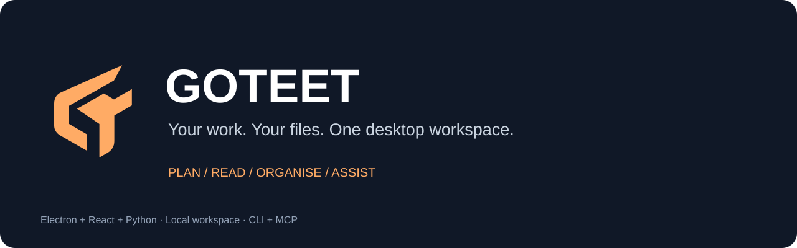
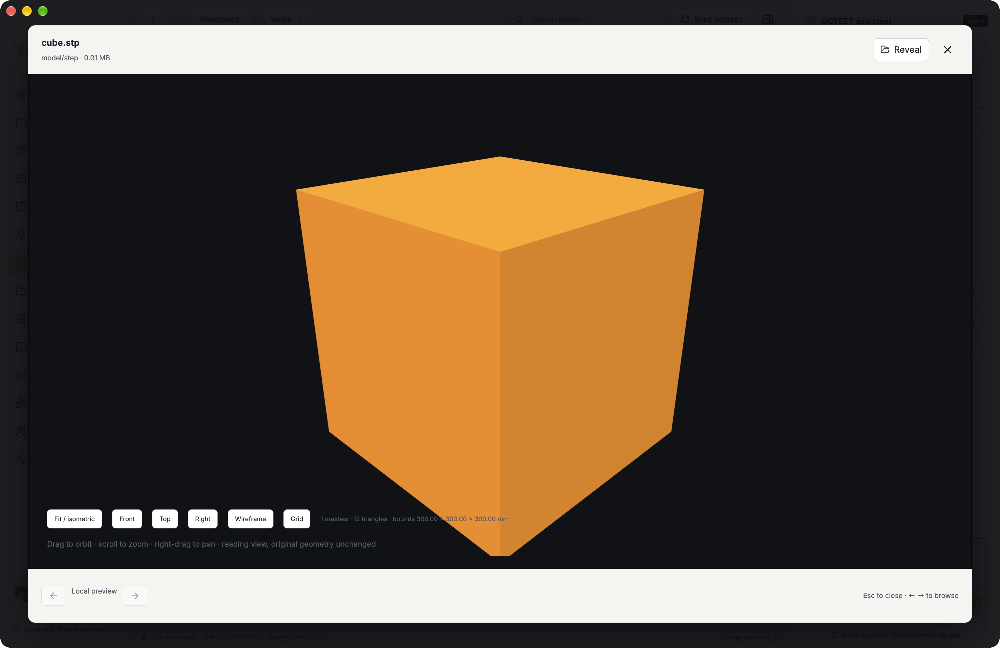
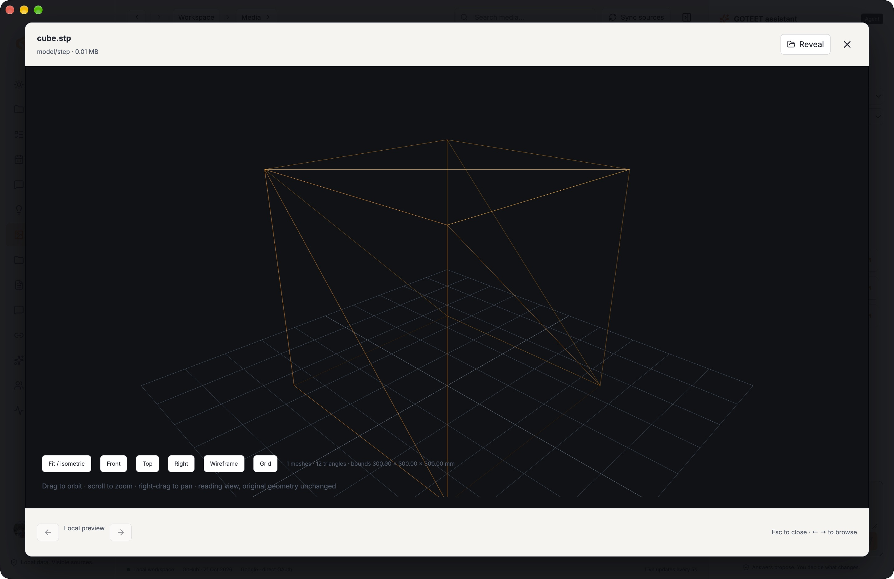
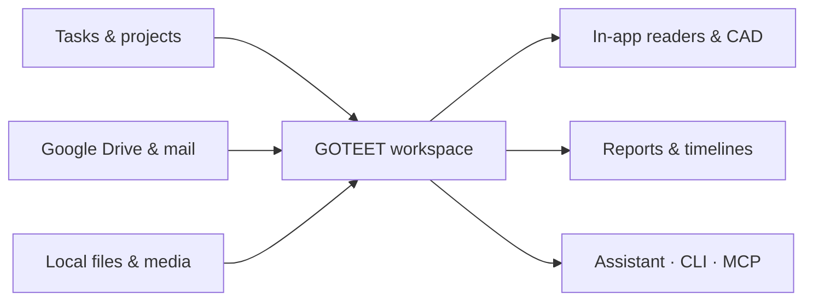

# GOTEET MVP



## Inside the app

Actual desktop captures using a public cube fixture. CAD previews preserve the original file.

| Solid CAD preview | Wireframe inspection |
| --- | --- |
|  |  |

STEP, IGES and BREP use OpenCascade via `occt-import-js`; STL, OBJ and embedded GLB use Three.js. View controls include fit, front, top, right, wireframe and grid. Native authoring formats are not universally supported.



Google sign-in requests identity and read-only Drive access. After granted consent, Drive metadata imports automatically; other Google sources remain optional. Google may require administrator approval or show testing-mode notices.


An integrated desktop work assistant following the requested spark-aigis-maker architecture: Electron + React/Vite + FastAPI, with SQLite. First packaging target is macOS arm64. Windows and Linux targets are defined but must be built and tested on those systems.

## Included

- Personal daily brief, development activity and evidence-linked follow-ups.
- Tasks with owners, priorities, status and due dates; project plans and timelines.
- Workspace chat channels with authenticated authors and member pairing credentials.
- Concepts editable live through desktop, API, CLI or MCP.
- Media thumbnails, grid/list views, format/source/collection filters, sorting and in-app image/video/audio/PDF/text/Office-text/3D previews.
- On-demand file explorer with visible paths, native copy/share and confirmed recoverable Trash.
- Project/task charts, linked project workspaces and restrained navigation motion.
- Profile photos and optional role, organisation, location, website and bio; accent, density, start view, timezone and reduced-motion preferences.
- Dedicated Models and Agents panels for CLI login, OS-keyring API accounts, Ollama/Hugging Face GGUF downloads, skills and MCP registrations.
- Measured resource gauges, top memory users and bounded storage review with AI explanations.
- About-only SPARKER credit and public GitHub release checking.
- Daily/weekly report history and export.
- Google Desktop OAuth with PKCE/state and OS credential storage. Import your own Desktop OAuth client JSON in Connections. Basic Google sign-in and optional read-only Gmail, Drive, Calendar, Contacts and Google Tasks access are separate choices. Enable those APIs and configure your consent audience/test users in the Google project. Use **Connect selected Google data** to open the system browser account chooser and consent screen. After consenting, return to Connections, check sign-in status and import selected data. Optional **Use Google name & photo** updates the local profile. Imports are bounded, show per-source capture times, and preserve older data on partial failure. Do not paste credentials in chat.
- Read-only Codex assistant using existing ChatGPT CLI login, plus local Ollama models.
- Microphone recording, local faster-whisper transcription and local system voice playback.

This is an MVP, not full Jira/Linear/Mattermost parity. Remote collaboration is not deployed. No paid hosting subscription or paid auth service is hardwired into the app. Third-party service limits, model availability and OAuth verification remain their providers' requirements.

## Run from source

Python 3.12 is required for the tested voice stack. Create `.venv312`, install `requirements-lock.txt`, then `npm ci && npm run build && npm run desktop`.

The desktop manages its backend lifetime. User state defaults to the OS app-data folder under `GOTEET/workspace`. For isolated development, set `WORKMATE_HOME` to a separate local directory. Do not use a production workspace for tests. Secrets and private inventory are not part of this repository or the distributable.

`WORKMATE_HOME` overrides the data root. OAuth tokens and client configuration use the OS credential store. The local API listens on a random loopback port with an owner-only runtime file. The app starts without Google login so local work remains usable while OAuth is being configured.

## Live Claude/Codex access

The bundled MCP server is registered with the local Codex CLI. Project-scoped `.mcp.json` provides the same server to Claude Code, which currently requires its normal approval. Existing unrelated servers were preserved. The 19 tools cover workspace data, media, files, system health, agent inventory and reviewed plans. Sending a message requires an explicit human instruction. See AGENT_ACCESS.md for the portable installed CLI, MCP and optional loopback CDP mode.

Run `.venv312/bin/python workmate_client.py status` while the app is open. List tasks with `tasks`. Create/update a task by piping JSON to `task`; project and concept commands work similarly. These clients call the live API rather than directly editing the database. Example payload:

```json
{"title":"Review the next release","project":"AIGIS","owner":"Sanju","status":"Todo","priority":"Normal","due":"","source_url":""}
```

## Team workspace deployment

Local chat persistence and separate member identities are implemented. For other devices, deploy the backend behind HTTPS and set `WORKMATE_SERVER_URL` and `WORKMATE_SERVER_TOKEN` before starting a desktop client. The owner can generate/revoke named member credentials. Members access shared tasks, project plans, concepts and channels; personal mail/files/reports/AI remain owner-only. Pairing does not send an invitation.

For server deployment, `WORKMATE_LISTEN_HOST` and `WORKMATE_PORT` choose the listener. Defaults remain loopback and a random port. Use an external HTTPS reverse proxy and restrict access; no remote listener has been enabled by this task. Google owner OAuth is designed for local desktop sign-in; production Google identity federation for team members is not implemented.

## Build

`scripts/package_backend.py` freezes the Python service for the current OS. Then `npm run build`, followed by `npm run package:mac`, `package:win` or `package:linux` on the appropriate OS. No CI release or remote publish is configured. Private snapshots and the task database must never be copied into distributable resources. The first local Mac build is unsigned.

## Reports

Daily and Friday weekly report automations are attached to the originating Codex chat. They depend on the local scheduler environment being available. They are not an always-on hosted reporting service. App reports show source capture times and stale/missing coverage. Historical comparison becomes more useful as successive snapshots accumulate.

See OPEN_SOURCE_REVIEW.md for the repository comparison and source/coverage limitations. See VERIFICATION.md for measured build and integration evidence.

Profile & settings is opened from the bottom-left account button. Permissions are enforced by the backend. File attachments can be added to saved tasks/projects/concepts and shared chat channels. System view shows measured hardware/resource state and available CLI tools.

### Single-copy Mac installation

Keep `/Applications/GOTEET.app` as the only installed app. After each package/install cycle and successful native verification, run `npm run cleanup:mac`. This checks the running installed version before deleting older/equal GOTEET bundles under `release/`, and refuses newer or running staging bundles. Source and workspace data are preserved.

## Fresh checkout (macOS Apple Silicon)

Requirements: Git, Node.js 22 or newer, npm, Python 3.12 and Xcode Command Line Tools. Google integration requires your own OAuth desktop client; the local app runs without it.

```sh
python3.12 -m venv .venv312
.venv312/bin/python -m pip install -r requirements-lock.txt
npm ci
.venv312/bin/python -m pytest -q
npm run build
npm run desktop
```

To package the native app:

```sh
.venv312/bin/python scripts/package_backend.py
npm run package:mac
```

Quit GOTEET, copy `release/mac-arm64/GOTEET.app` to `/Applications/GOTEET.app`, launch it and verify the UI, then run `npm run cleanup:mac`. Do not run the release staging copy as a second installation. Windows/Linux builds need native dependency validation on their respective OS; the current Python lock was verified on macOS ARM64.

## Development status

v0.5.1 includes the calendar/board planner, formatted reports, task completion controls, Drive folder navigation, document readers and theme contrast repairs. App-activity sampling is an unfinished backend feature, disabled by default; its settings panel and reporting integration are not yet complete. Drive content viewing still requires the relevant Google consent.

## Source licenses

The distribution includes an AGPL-3.0 Plane date helper; see `src/vendor/plane-dates.ts`, `public/licenses/plane-AGPL-3.0.txt` and `READER_REFERENCES.md`. Preserve its attribution and comply with the applicable source-distribution terms when redistributing the combined app. PDF.js license is also included in `public/licenses/`.
